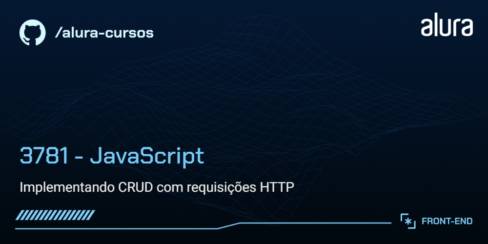

<div align="center">


  

</div>

# Memoteca

A Memoteca é uma aplicação web para guardar pensamentos, frases e citações com autoria e data. A interface em JavaScript se comunica com uma API REST local criada com JSON Server.



## Funcionalidades

- Cadastrar, listar, editar e excluir pensamentos;
- Pesquisar por palavras no conteúdo ou na autoria;
- Marcar pensamentos como favoritos;
- Validar campos e impedir datas futuras;
- Salvar os dados na API local, que os mantém no arquivo `backend/db.json`.

## Tecnologias

- HTML5 e CSS3;
- JavaScript com módulos ES;
- Axios para as requisições HTTP;
- Node.js e JSON Server como API de desenvolvimento.

O projeto também tem um [layout no Figma](https://www.figma.com/design/Sz1gmmemxqcB3amInL4Ndp/Rebrand-Memoteca-%7C-Curso-CRUD?node-id=148-26&t=FpdmfbiM1i1s6REQ-0).

## Como executar

Você precisa do **Node.js e npm**. O frontend carrega o Axios por CDN, então mantenha conexão com a internet durante o uso.

### 1. Baixe o projeto

```bash
git clone https://github.com/elitohn/Pensamentos-CRUD-Aplica-o-JavaScript-com-API-REST.git
cd Pensamentos-CRUD-Aplica-o-JavaScript-com-API-REST
```

### 2. Instale o JSON Server

O `package.json` do backend define o comando de inicialização, mas não instala o JSON Server como dependência local. Instale-o globalmente:

```bash
npm install --global json-server
```

### 3. Inicie a API

Em um terminal, entre na pasta `backend` e inicie o servidor:

```bash
cd backend
npm start
```

A API ficará disponível em [http://localhost:3000/pensamentos](http://localhost:3000/pensamentos). Deixe esse terminal aberto.

### 4. Inicie o frontend

Em outro terminal, volte à pasta raiz do repositório e inicie um servidor estático:

```bash
python -m http.server 5500
```

No Windows, também é possível usar:

```powershell
py -m http.server 5500
```

Abra [http://localhost:5500](http://localhost:5500) no navegador. Também é possível abrir `index.html` com a extensão Live Server do VS Code.

## Estrutura

```text
.
├── assets/
├── backend/
│   ├── db.json
│   └── package.json
├── css/
├── js/
│   ├── api.js
│   ├── main.js
│   └── ui.js
├── index.html
└── thumb.png
```

## Observações

- A API é local e serve para desenvolvimento; não há implantação de backend público.
- A lista e as alterações são persistidas no `backend/db.json` da sua cópia do projeto.
- Para encerrar os servidores, pressione `Ctrl+C` nos terminais correspondentes.

Projeto desenvolvido durante estudos de JavaScript e operações CRUD.
